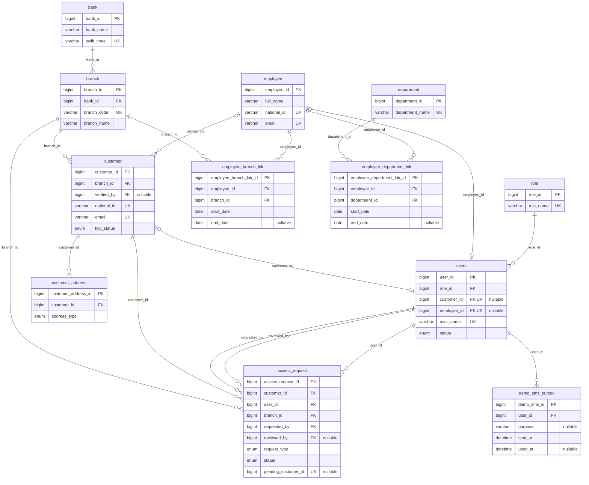
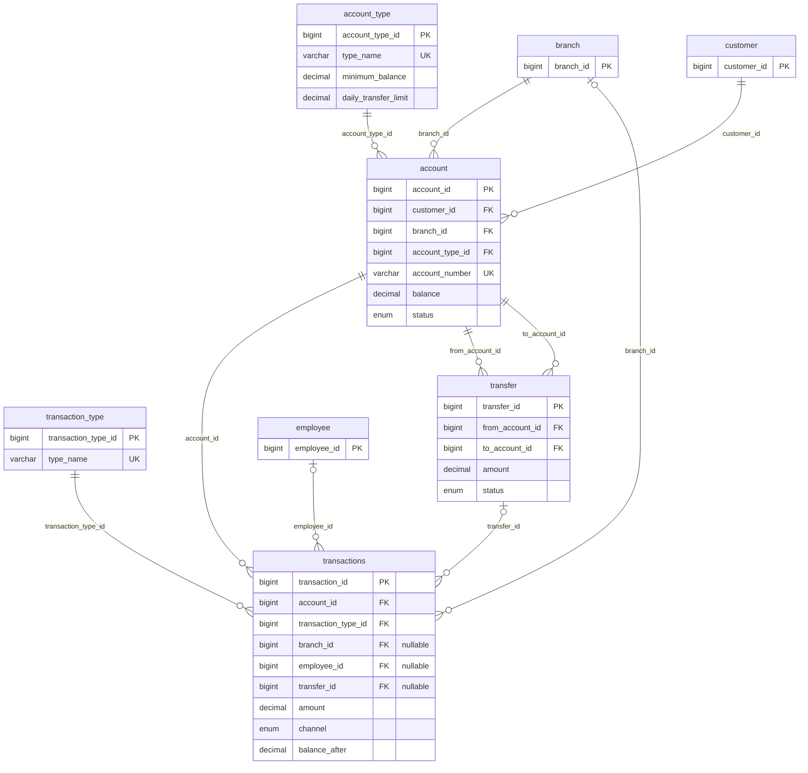
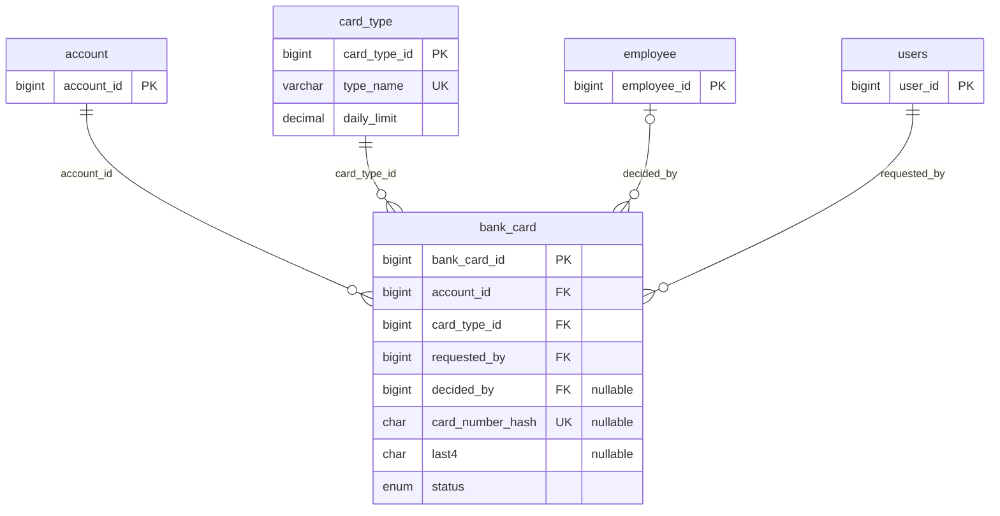
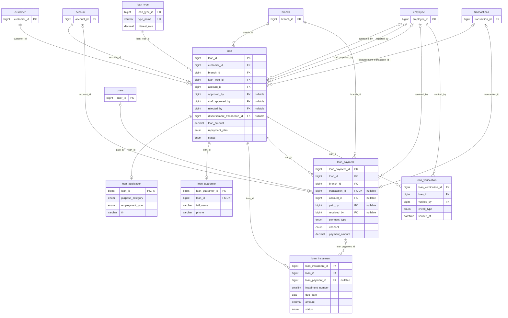
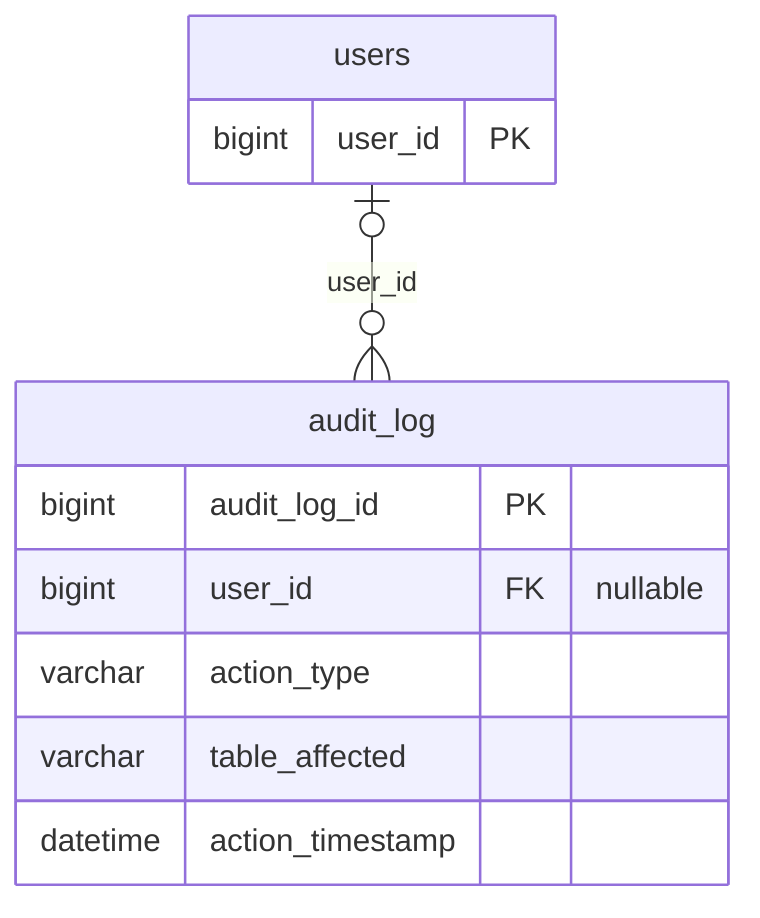

# Diamond Bank: Entity Relationship Diagram

Diamond Bank stores everything in one MySQL 8.4 database, `bank_db`. Laravel migrations
(`backend/database/migrations`) create the schema, and the money-moving operations run as
stored procedures inside it (see [Stored procedures and functions](#stored-procedures-and-functions)).

These diagrams show the **27 bank tables** and **all 52 foreign keys** between them. They were read
from `information_schema` on the test database `bank_db_testing`, which has the same 39 migrations
applied. Laravel's own tables are left out because nothing in the bank schema references them:
`sessions`, `cache`, `cache_locks`, `jobs`, `job_batches`, `failed_jobs` and `migrations`.

How to read the diagrams:

- Each box shows the primary key (`PK`), every foreign key (`FK`), unique columns (`UK`) and a
  few key columns. It does not list every column. `"nullable"` marks a column that may be NULL.
- Each line is one foreign key, and its label is the FK column name. A table with several FKs to
  the same table (for example `loan` to `employee`) has one line for each.
- Cardinality comes from the schema. A `NOT NULL` FK is drawn as "exactly one" on the parent side
  (`||`), and a nullable FK as "zero or one" (`|o`). A unique FK is drawn as "zero or one" on the
  child side (`o|`), and any other FK as "zero or many" (`o{`).
- Every foreign key is `ON DELETE RESTRICT`. The schema has no triggers and no views.

## Full diagram

All 27 tables and all 52 relationships.

```mermaid
erDiagram
    access_request {
        bigint access_request_id PK
        bigint customer_id FK
        bigint user_id FK
        bigint branch_id FK
        bigint requested_by FK
        bigint reviewed_by FK "nullable"
        enum request_type
        enum status
        bigint pending_customer_id UK "nullable"
    }
    account {
        bigint account_id PK
        bigint customer_id FK
        bigint branch_id FK
        bigint account_type_id FK
        varchar account_number UK
        decimal balance
        enum status
    }
    account_type {
        bigint account_type_id PK
        varchar type_name UK
        decimal minimum_balance
        decimal daily_transfer_limit
    }
    audit_log {
        bigint audit_log_id PK
        bigint user_id FK "nullable"
        varchar action_type
        varchar table_affected
        datetime action_timestamp
    }
    bank {
        bigint bank_id PK
        varchar bank_name
        varchar swift_code UK
    }
    bank_card {
        bigint bank_card_id PK
        bigint account_id FK
        bigint card_type_id FK
        bigint requested_by FK
        bigint decided_by FK "nullable"
        char card_number_hash UK "nullable"
        char last4 "nullable"
        enum status
    }
    branch {
        bigint branch_id PK
        bigint bank_id FK
        varchar branch_code UK
        varchar branch_name
    }
    card_type {
        bigint card_type_id PK
        varchar type_name UK
        decimal daily_limit
    }
    customer {
        bigint customer_id PK
        bigint branch_id FK
        bigint verified_by FK "nullable"
        varchar national_id UK
        varchar email UK
        enum kyc_status
    }
    customer_address {
        bigint customer_address_id PK
        bigint customer_id FK
        enum address_type
    }
    demo_sms_outbox {
        bigint demo_sms_id PK
        bigint user_id FK
        varchar purpose "nullable"
        datetime sent_at
        datetime used_at "nullable"
    }
    department {
        bigint department_id PK
        varchar department_name UK
    }
    employee {
        bigint employee_id PK
        varchar full_name
        varchar national_id UK
        varchar email UK
    }
    employee_branch_lnk {
        bigint employee_branch_lnk_id PK
        bigint employee_id FK
        bigint branch_id FK
        date start_date
        date end_date "nullable"
    }
    employee_department_lnk {
        bigint employee_department_lnk_id PK
        bigint employee_id FK
        bigint department_id FK
        date start_date
        date end_date "nullable"
    }
    loan {
        bigint loan_id PK
        bigint customer_id FK
        bigint branch_id FK
        bigint loan_type_id FK
        bigint account_id FK
        bigint approved_by FK "nullable"
        bigint staff_approved_by FK "nullable"
        bigint rejected_by FK "nullable"
        bigint disbursement_transaction_id FK "nullable"
        decimal loan_amount
        enum repayment_plan
        enum status
    }
    loan_application {
        bigint loan_id PK, FK
        enum purpose_category
        enum employment_type
        varchar tin
    }
    loan_guarantor {
        bigint loan_guarantor_id PK
        bigint loan_id FK, UK
        varchar full_name
        varchar phone
    }
    loan_instalment {
        bigint loan_instalment_id PK
        bigint loan_id FK
        bigint loan_payment_id FK "nullable"
        smallint instalment_number
        date due_date
        decimal amount
        enum status
    }
    loan_payment {
        bigint loan_payment_id PK
        bigint loan_id FK
        bigint branch_id FK
        bigint transaction_id FK, UK "nullable"
        bigint account_id FK "nullable"
        bigint paid_by FK "nullable"
        bigint received_by FK "nullable"
        enum payment_type
        enum channel
        decimal payment_amount
    }
    loan_type {
        bigint loan_type_id PK
        varchar type_name UK
        decimal interest_rate
    }
    loan_verification {
        bigint loan_verification_id PK
        bigint loan_id FK
        bigint verified_by FK
        enum check_type
        datetime verified_at
    }
    role {
        bigint role_id PK
        varchar role_name UK
    }
    transaction_type {
        bigint transaction_type_id PK
        varchar type_name UK
    }
    transactions {
        bigint transaction_id PK
        bigint account_id FK
        bigint transaction_type_id FK
        bigint branch_id FK "nullable"
        bigint employee_id FK "nullable"
        bigint transfer_id FK "nullable"
        decimal amount
        enum channel
        decimal balance_after
    }
    transfer {
        bigint transfer_id PK
        bigint from_account_id FK
        bigint to_account_id FK
        decimal amount
        enum status
    }
    users {
        bigint user_id PK
        bigint role_id FK
        bigint customer_id FK, UK "nullable"
        bigint employee_id FK, UK "nullable"
        varchar user_name UK
        enum status
    }
    branch ||--o{ access_request : "branch_id"
    customer ||--o{ access_request : "customer_id"
    users ||--o{ access_request : "requested_by"
    users |o--o{ access_request : "reviewed_by"
    users ||--o{ access_request : "user_id"
    account_type ||--o{ account : "account_type_id"
    branch ||--o{ account : "branch_id"
    customer ||--o{ account : "customer_id"
    users |o--o{ audit_log : "user_id"
    account ||--o{ bank_card : "account_id"
    card_type ||--o{ bank_card : "card_type_id"
    employee |o--o{ bank_card : "decided_by"
    users ||--o{ bank_card : "requested_by"
    bank ||--o{ branch : "bank_id"
    branch ||--o{ customer : "branch_id"
    employee |o--o{ customer : "verified_by"
    customer ||--o{ customer_address : "customer_id"
    users ||--o{ demo_sms_outbox : "user_id"
    branch ||--o{ employee_branch_lnk : "branch_id"
    employee ||--o{ employee_branch_lnk : "employee_id"
    department ||--o{ employee_department_lnk : "department_id"
    employee ||--o{ employee_department_lnk : "employee_id"
    account ||--o{ loan : "account_id"
    employee |o--o{ loan : "approved_by"
    branch ||--o{ loan : "branch_id"
    customer ||--o{ loan : "customer_id"
    transactions |o--o{ loan : "disbursement_transaction_id"
    loan_type ||--o{ loan : "loan_type_id"
    employee |o--o{ loan : "rejected_by"
    employee |o--o{ loan : "staff_approved_by"
    loan ||--o| loan_application : "loan_id"
    loan ||--o| loan_guarantor : "loan_id"
    loan ||--o{ loan_instalment : "loan_id"
    loan_payment |o--o{ loan_instalment : "loan_payment_id"
    account |o--o{ loan_payment : "account_id"
    branch ||--o{ loan_payment : "branch_id"
    loan ||--o{ loan_payment : "loan_id"
    users |o--o{ loan_payment : "paid_by"
    employee |o--o{ loan_payment : "received_by"
    transactions |o--o| loan_payment : "transaction_id"
    loan ||--o{ loan_verification : "loan_id"
    employee ||--o{ loan_verification : "verified_by"
    account ||--o{ transactions : "account_id"
    branch |o--o{ transactions : "branch_id"
    employee |o--o{ transactions : "employee_id"
    transaction_type ||--o{ transactions : "transaction_type_id"
    transfer |o--o{ transactions : "transfer_id"
    account ||--o{ transfer : "from_account_id"
    account ||--o{ transfer : "to_account_id"
    customer |o--o| users : "customer_id"
    employee |o--o| users : "employee_id"
    role ||--o{ users : "role_id"
```

## Diagrams by area

Each relationship is drawn in the area of the table that **holds** the foreign key. Tables from
other areas appear as small boxes with only their primary key, so each line has both ends.
Together, the five diagrams show all 52 relationships exactly once.

### People and access

Logins (`users`) and their roles, customers and their addresses, staff (`employee`) and their
branch and department history, the bank and its branches, access-recovery requests, and the
demo SMS outbox.

### Accounts and money

Accounts, their types, every balance movement (`transactions`), and transfers between accounts.

### Cards

Debit cards, from the customer's request to staff issuing or rejecting them.

### Loans

A loan, plus its application details, guarantor, staff verification checks, repayment
schedule (`loan_instalment`) and payments.

### Audit

## Cardinality notes

These are the relationships that are not a plain "one parent, many children":

- **`users` to `customer` / `employee` is zero-or-one on both sides.** `users.customer_id` and
  `users.employee_id` are both nullable and unique. A customer or employee has at most one login,
  and the schema allows a login linked to neither.
- **`loan` to `loan_application` is one-to-zero-or-one.** `loan_application.loan_id` is both its
  primary key and its FK.
- **`loan` to `loan_guarantor` is one-to-zero-or-one.** `loan_guarantor.loan_id` is unique.
- **`transactions` to `loan_payment` is zero-or-one on both sides.** `loan_payment.transaction_id`
  is nullable (a cash payment has no account transaction) and unique.
- **`loan_instalment` is one-to-many from `loan`.** The unique key `(loan_id, instalment_number)`
  allows each instalment number only once per loan. `loan_instalment.loan_payment_id` is nullable
  and stays NULL until a payment covers the instalment.
- **`loan_verification` is one-to-many from `loan`.** The unique key `(loan_id, check_type)` allows
  each type of check only once per loan.
- **A customer can have only one pending `access_request` at a time.** The generated column
  `pending_customer_id` equals `customer_id` while `status = 'PENDING'` and is NULL otherwise, and
  it has a unique key. Requests that are no longer pending don't count.
- **`employee_branch_lnk` and `employee_department_lnk` are history tables.** They have
  `start_date`/`end_date` and no unique key on `employee_id`, so the schema allows an employee
  many rows (and many branches or departments over time). Neither FK is one-to-one.
- **`transfer` references `account` twice** (`from_account_id`, `to_account_id`), and each
  transfer's two `transactions` rows point back to it through the nullable `transactions.transfer_id`.
- **Optional staff columns** (`approved_by`, `staff_approved_by`, `rejected_by`, `verified_by` on
  `customer`, `decided_by`, `received_by`, `reviewed_by`) are nullable because they are only set
  once someone acts on the record. `loan_verification.verified_by` is the exception: it is
  required, because the row is the check itself.

## Stored procedures and functions

There are 6 procedures and 2 functions. "Reads" lists the tables each one selects from (including
`FOR UPDATE` row locks), and "Writes" lists the tables it inserts into or updates. No routine deletes rows.

| Routine | Type | What it does | Reads | Writes |
|---|---|---|---|---|
| `sp_open_account` | procedure | Staff or admin opens an account for a KYC-verified customer, sets its number (`DB` + branch + id) and records any opening deposit | `users`, `role`, `customer`, `branch`, `account_type`, `transaction_type` | `account`, `transactions`, `audit_log` |
| `sp_deposit` | procedure | Cash deposit by staff or admin, recorded at their current branch (from `employee_branch_lnk`) | `users`, `role`, `employee_branch_lnk`, `account`, `transaction_type` | `account`, `transactions`, `audit_log` |
| `sp_withdraw` | procedure | Cash withdrawal by staff or admin at their current branch, keeping the account type's minimum balance | `users`, `role`, `employee_branch_lnk`, `account`, `account_type`, `transaction_type` | `account`, `transactions`, `audit_log` |
| `sp_transfer_funds` | procedure | Transfer between two accounts (a customer only from their own), enforcing the minimum balance and the per-account daily limit with both rows locked | `users`, `role`, `account`, `account_type`, `transaction_type`, `transfer` | `transfer`, `transactions`, `account`, `audit_log` |
| `sp_disburse_loan` | procedure | Admin's final approval: pays the loan into the customer's account and stores its repayment schedule | `users`, `role`, `transaction_type`, `loan`, `account`, `customer` | `account`, `transactions`, `loan_instalment`, `loan`, `audit_log` |
| `sp_repay_loan` | procedure | Takes a loan payment (from an account, or as cash at a branch), marks the instalments it covers, and closes the loan when nothing is left unpaid | `users`, `role`, `employee_branch_lnk`, `transaction_type`, `loan`, `account`, `account_type`, `loan_instalment` | `account`, `transactions`, `loan_payment`, `loan_instalment`, `loan`, `audit_log` |
| `fn_transfer_day_start` | function | Start of the current bank day (Africa/Banjul) | none | none |
| `fn_transferred_today` | function | Total of today's completed transfers out of one account | `transfer` | none |

Calls between routines:

- `sp_transfer_funds` calls `fn_transfer_day_start()` and uses the same filter as
  `fn_transferred_today` for the daily limit.
- `fn_transferred_today` calls `fn_transfer_day_start()`. The backend calls it from
  `app/Support/DailyTransferLimit.php` to show how much of the limit is left.
- `sp_disburse_loan` reads its schedule from a JSON parameter (`JSON_TABLE`), not from a table.
