# Diamond Bank: Software Requirements Specification

**Prepared by:** Jennifer Onyedika
**Version:** 1.0
**Date:** 20 October 2026

---

## Contents

1. [Introduction / Project overview](#1-introduction--project-overview)
2. [Purpose](#2-purpose)
3. [Aim](#3-aim)
4. [Objectives](#4-objectives)
5. [Problem statement](#5-problem-statement)
6. [Scope](#6-scope)
7. [Out of scope](#7-out-of-scope)
8. [Stakeholders](#8-stakeholders)
9. [User roles](#9-user-roles)
10. [Functional requirements](#10-functional-requirements)
11. [Status workflows](#11-status-workflows)
12. [Payment / transaction requirements](#12-payment--transaction-requirements)
13. [Notifications](#13-notifications)
14. [Reporting](#14-reporting)
15. [Non-functional requirements](#15-non-functional-requirements)
16. [Database requirements](#16-database-requirements)
17. [Business rules](#17-business-rules)
18. [Assumptions](#18-assumptions)
19. [Constraints](#19-constraints)
20. [Feasibility](#20-feasibility)
21. [SMART goals](#21-smart-goals)
22. [Use cases](#22-use-cases)
23. [System architecture](#23-system-architecture)
24. [Security requirements](#24-security-requirements)
25. [Testing](#25-testing)
26. [Acceptance criteria](#26-acceptance-criteria)
27. [Risk analysis](#27-risk-analysis)
28. [Future enhancements](#28-future-enhancements)
29. [Deliverables](#29-deliverables)
30. [Conclusion](#30-conclusion)

---

## 1. Introduction / Project overview

Diamond Bank is a web-based core banking system for a bank in The Gambia. Customers use it to view
their accounts, send transfers, request debit cards and apply for and repay loans. Branch staff use it
to verify customers, open accounts, handle cash, issue cards and review loans. An administrator uses it
to set up the bank and its branches, approve staff, give final loan approval and restore access for
locked-out users.

The system is made up of three parts:

- a **React** single-page web application (the frontend);
- a **Laravel** REST API under `/api/v1` (the backend);
- a **MySQL 8** database, `bank_db`, in which every movement of money is carried out by **stored procedures**.

All amounts are in Gambian dalasi (GMD).

This document describes the system **as it is built**. Anything that is not built is listed in
[Out of scope](#7-out-of-scope) or [Future enhancements](#28-future-enhancements), never in the requirements.

## 2. Purpose

This Software Requirements Specification (SRS) states what Diamond Bank does and the rules it follows.
It is written for:

- the **developer**, as the reference for behaviour and rules;
- the **project assessor**, to judge the system against stated requirements;
- **bank stakeholders**, to understand what each role can do and how money and data are protected.

## 3. Aim

To provide a secure, auditable web banking system in which customers can serve themselves online and branch
staff and an administrator can run the bank's daily operations, with every movement of money enforced by the database.

## 4. Objectives

1. Let customers register online, view their accounts and transactions, transfer money, manage debit
   cards and apply for and repay loans without visiting a branch.
2. Give branch staff the tools to verify customers (KYC), open accounts, record cash deposits and
   withdrawals, issue cards and review loans for their own branch.
3. Require two approvals for every loan: a staff member at the loan's branch, then an administrator.
4. Carry out every movement of money inside a stored procedure, with row locking, so that balances stay
   correct even when operations happen at the same time.
5. Record every sign-in and every change to money, customers, staff, cards, loans and settings in an audit log.
6. Let users who are locked out regain access safely, without any person seeing or choosing their password.

## 5. Problem statement

A bank that relies on paper forms and branch-only services makes customers travel and queue for simple
tasks such as checking a balance or moving money between accounts. Manual records are slow to search, easy
to get wrong and hard to audit. Without central controls, two operations on the same account at the same time
can produce a wrong balance, one person can approve their own work, and there may be no reliable record of who
changed what. Customers who forget their password or are locked out need a way back in that does not
expose their account to staff or impostors.

Diamond Bank addresses these problems with online self-service, staff tools scoped to a branch, approval
by two people, money rules enforced in the database, a full audit trail and a controlled access-recovery process.

## 6. Scope

The following features are in scope and built.

| Area | In scope |
|---|---|
| Accounts and authentication | Customer self-registration; staff self-registration with admin approval; sign-in and sign-out; forced password change; change password; wrong-password lockout; idle logout. |
| Customers and KYC | Staff search and view customers at every branch; edit details, verify or reject KYC, and block or unblock logins at their own branch; admin read-only customer view and username change. |
| Accounts and money | Staff open accounts with an initial deposit; cash deposits and withdrawals; freeze and unfreeze; customers view accounts and transaction history. |
| Transfers | Customer transfers to any active account, with recipient lookup, password confirmation and a daily limit per account. |
| Cards | Customer requests, blocks and reveals a debit card; staff issue, reject and unblock cards. |
| Loans | Live quote; 4-step application; staff checks and first approval; admin final approval with disbursement; rejection and cancellation; online and cash repayment; early payoff. |
| Access recovery | Staff raise an access request for a locked-out customer; admin approves or rejects; admin restores access for staff; temporary passwords. |
| Administration | Bank settings; branches; account types; card types; loan types; departments; staff approval, rejection, blocking and unblocking; username changes. |
| Audit | Audit log with filters, scoped by role. |
| Notifications | Demo SMS outbox (simulated text messages). |
| Overview and dashboard | Admin Overview counts; staff Dashboard. |

## 7. Out of scope

The following are **not** built. Some appear as values in the database but no feature uses them.

- **Closing accounts.** The account status `CLOSED` exists in the schema, but no feature closes an account.
- **Card expiry processing.** A card's expiry date is stored, but nothing changes a card to `EXPIRED`.
- **Card payments** and enforcing a card type's daily limit (the limit is stored but not used).
- **Reversals.** The statuses `FAILED`/`REVERSED` on transfers and `REVERSED` on loan payments exist in
  the schema but are never set. Every transfer is recorded as `COMPLETED`.
- **Mobile and ATM channels.** The transaction channels `MOBILE` and `ATM` and the login channel
  `MOBILE` exist in the schema but are never used.
- Account statements, exports and printed reports; daily totals and charts.
- Interest on savings accounts.
- More than one currency (only GMD).
- Real SMS or email delivery; one-time codes (OTP).
- Gamcel phone numbers.
- A mobile app.
- Online deployment with HTTPS (the system runs locally).

## 8. Stakeholders

| Stakeholder | Interest | Interaction with the system |
|---|---|---|
| Bank management | A reliable, auditable banking operation. | Through the administrator and reports (Overview). |
| Administrator | Set up the bank, control staff, give final loan approval, restore access. | Admin area. |
| Branch staff | Serve customers at the branch efficiently. | Staff area. |
| Customers | Safe access to their money and services online. | Customer area. |
| Loan guarantors | Their details are used to support a loan. | No login; staff contact them during loan checks. |
| Regulators (Central Bank of The Gambia; PURA for phone numbering) | Sound banking practice; valid phone numbers. | Indirect: the phone rule follows PURA's 2026 numbering. |
| Project supervisor / assessor | A system that meets its stated requirements. | Reviews this document, the code and the tests. |

## 9. User roles

There are three roles, stored in the `role` table: **customer**, **staff** and **admin**.

### Customer

- **Account creation:** registers online on the *Open an account* page (`/register`), choosing a home branch.
  The login is active straight away, and KYC starts as pending.
- **After sign-in:** lands on *Overview* (`/customer`).
- **Can:** view their own accounts and transactions, transfer money, request, block and reveal cards,
  apply for, cancel and repay loans, view their profile and change their password.
- **Cannot:** see any other customer's data. Another customer's account, card or loan is answered with
  "not found". Cannot open accounts or change their own KYC status.

### Staff

- **Account creation:** registers on the public staff sign-up page (`/register/staff`). The login stays
  pending until an administrator approves it and assigns a branch (and optionally a department).
- **After sign-in:** lands on *Dashboard* (`/staff`).
- **Branch scoping:** each staff member has one current branch, and staff without a current branch are refused.
  Viewing customers and recording cash deposits and withdrawals are allowed at **every** branch.
  Changing a customer (details, KYC, login block, access requests), freezing accounts, and handling cards
  and loans are limited to **their own branch**.
- **Cannot:** give final loan approval, manage bank settings or reference data, or manage staff.

### Admin

- **Account creation:** created by the database seeder (`AdminSeeder`) from `ADMIN_USERNAME` and
  `ADMIN_PASSWORD`. The password must be changed at the first sign-in.
- **After sign-in:** lands on *Overview* (`/admin`).
- **Can:** do everything in the admin area, and read the audit log (all rows).
- **Cannot:** see or set any user's password. There is no such route.

## 10. Functional requirements

### 10.1 Authentication and session

- **FR-001** The system shall let a person aged 18 or over register as a customer with personal details
  (name, date of birth, gender, national ID), a home branch, a Gambian mobile number, an email address, a username and a password. The login shall be active
  immediately, with KYC status `PENDING`.
- **FR-002** The system shall let a person register as staff on a public sign-up page. The login shall have
  status `PENDING` and shall not be able to sign in until an administrator approves it.
- **FR-003** The system shall let an active user sign in with username and password, and sign out.
- **FR-004** The system shall send each user to their role's area after sign-in (`/customer`, `/staff` or `/admin`).
- **FR-005** The system shall force a user whose password must be changed (the seeded admin at first
  sign-in, or any user with a temporary password) to change it before using any other feature.
  Only sign-out and change password shall be available until then.
- **FR-006** The system shall let a signed-in user change their password after confirming the current one.
- **FR-007** The system shall count wrong passwords per user across the sign-in page and the in-app password checks,
  and apply the lockout in [BR-017](#17-business-rules).
- **FR-008** The system shall log a session out on the server after a period with no user activity
  (clicks, typing, navigation), as set by `IDLE_TIMEOUT_MINUTES`. Background requests shall not count as activity.
- **FR-009** The system shall show a warning with a countdown 60 seconds before the idle logout. All open
  tabs shall share the timer and log out together.

### 10.2 Customer self-service

- **FR-010** The system shall show a customer an Overview of their accounts with balances and their recent transactions.
- **FR-011** The system shall list a customer's accounts and show each account's details and paginated transaction history.
- **FR-012** The system shall show a customer their profile (personal details, home branch, addresses) read-only.

### 10.3 Transfers

- **FR-013** The system shall let a customer look up a destination account by account number before
  transferring, and show the holder's name masked.
- **FR-014** The system shall let a customer transfer money from one of their own active accounts to any other
  active account in the same currency, after confirming their password.
- **FR-015** The system shall show how much of the source account's daily transfer limit is left today.
- **FR-016** The system shall refuse a transfer that would take the source account below its minimum
  balance or over its daily transfer limit, and say why.

### 10.4 Cards

- **FR-017** The system shall let a KYC-verified customer request a debit card of a chosen card type for
  one of their active accounts.
- **FR-018** The system shall let a customer block one of their active cards (for example, a lost card).
- **FR-019** The system shall show a card's full number to its owner only, after the owner confirms their
  password. Everywhere else the number shall be masked.
- **FR-020** The system shall let staff issue a requested card on an account at their branch. Issuing
  generates the card number and sets the issue date and expiry date.
- **FR-021** The system shall let staff reject a card request with a reason that the customer can see.
- **FR-022** The system shall let staff unblock a blocked card on an account at their branch.

### 10.5 Loans

- **FR-023** The system shall give a customer a live quote (instalment, total interest, total repayable,
  schedule) as they choose the loan type, amount, term and repayment plan. The quote shall be calculated
  by the backend, not the browser.
- **FR-024** The system shall let a KYC-verified customer with no open loan apply in four steps:
  terms, employment and income, guarantor, and review. The loan is created with status `PENDING`.
- **FR-025** The system shall let a customer cancel their loan while it is `PENDING` or `AWAITING_ADMIN`.
- **FR-026** The system shall let staff at the loan's branch record the four checks: bank statement
  reviewed, employment verified, guarantor contacted, and guarantor's occupation verified.
- **FR-027** The system shall show staff and admins the applicant's transactions for the last 6 months
  (`BANK_LOAN_STATEMENT_MONTHS`) when reviewing a loan.
- **FR-028** The system shall warn staff and admins when the monthly repayment is above the affordability
  percentage of the declared income (see [BR-012](#17-business-rules)).
- **FR-029** The system shall let staff at the loan's branch give the first approval once all four checks are
  recorded (status becomes `AWAITING_ADMIN`), or reject a `PENDING` loan with a reason.
- **FR-030** The system shall let an administrator give the final approval of an `AWAITING_ADMIN` loan from any
  branch. This pays the loan into the customer's account and saves the repayment schedule (`sp_disburse_loan`).
- **FR-031** The system shall let an administrator reject an `AWAITING_ADMIN` loan with a reason.
- **FR-032** The system shall show the customer their loan's status, terms, repayment schedule and payment history.
- **FR-033** The system shall let a customer pay online from one of their accounts, after confirming their
  password: either the next instalment or the whole loan early (early payoff).
- **FR-034** The system shall let staff at the loan's branch record a cash repayment (next instalment or early payoff).
- **FR-035** The system shall close a loan automatically when no unpaid instalment remains.

### 10.6 Staff customer and account management

- **FR-036** The system shall let staff search customers (by name, ID number, phone, email or username)
  and filter them by KYC status, at every branch.
- **FR-037** The system shall let staff view any customer's details, accounts, cards and login status.
- **FR-038** The system shall let staff edit a customer's details at their own branch. The national ID can
  only be changed while KYC is pending.
- **FR-039** The system shall let staff verify or reject a `PENDING` customer's KYC at their own branch,
  rejecting with a reason.
- **FR-040** The system shall let staff block an active customer login with a reason, and unblock a
  manually blocked one, at their own branch. A login blocked by the wrong-password lockout shall need an access request instead.
- **FR-041** The system shall let staff open an account for a KYC-verified customer at the staff member's
  current branch, choosing the account type, with an initial deposit of at least the type's minimum balance (`sp_open_account`).
- **FR-042** The system shall let staff record cash deposits and withdrawals on any active account at any
  branch (`sp_deposit`, `sp_withdraw`). The transaction is recorded at the staff member's current branch.
- **FR-043** The system shall let staff freeze and unfreeze accounts at their own branch. A frozen account
  shall not send or receive money.
- **FR-044** The system shall show staff a quick search on their Dashboard: an account number opens the
  account, and anything else searches customers.

### 10.7 Access recovery

- **FR-045** The system shall let staff at a customer's home branch raise an access request for a customer
  whose login is blocked by the wrong-password lockout or whose temporary password expired. Staff shall
  record how the customer made contact (branch visit or phone call), confirm the identity checks, and
  choose *unblock only* or *unblock and reset password*.
- **FR-046** The system shall allow at most one pending access request per customer.
- **FR-047** The system shall let an administrator approve or reject an access request, rejecting with a reason.
- **FR-048** On approval, the system shall reactivate the login, clear the lockout count and end the user's
  sessions. For *unblock and reset*, it shall also generate a random 12-character temporary password,
  send it by (demo) SMS, require it to be changed at the next sign-in, and refuse it once it has expired.
- **FR-049** The system shall let an administrator restore access directly for a staff member who is locked
  out or holds an expired temporary password, with the same effects as FR-048.
- **FR-050** The system shall never show a temporary password in the API, the interface or the logs.

### 10.8 Administration

- **FR-051** The system shall let the administrator view and save the bank's details (name, SWIFT code, date
  established) on *Bank settings*. There is only one bank.
- **FR-052** The system shall let the administrator create, edit and delete branches, account types (with
  minimum balance and daily transfer limit), card types (with daily limit), loan types (with annual interest
  rate) and departments.
- **FR-053** The system shall let the administrator approve a pending staff registration, assigning a branch
  and optionally a department, or reject it.
- **FR-054** The system shall let the administrator block an active staff login (ending their sessions) and unblock it.
- **FR-055** The system shall let the administrator change a customer's or staff member's username.
- **FR-056** The system shall give the administrator a read-only list and detail view of every customer.
- **FR-057** The system shall show the administrator the bank-wide Overview counts (see [Reporting](#14-reporting)).

### 10.9 Audit log

- **FR-058** The system shall record sign-ins, failed sign-ins, lockouts and every change to money,
  customers, staff, cards, loans and settings, with the user, action, table, record, details, IP address and time.
- **FR-059** The system shall show the audit log newest first, filterable by action, table, username and date range.
- **FR-060** The system shall show staff only their branch's rows (actions by staff working at the branch,
  and by customers whose home branch it is), and show the administrator every row.

### 10.10 Demo SMS outbox

- **FR-061** The system shall save every text message it "sends" in the `demo_sms_outbox` table instead of
  sending it.
- **FR-062** The system shall show the messages from the last 24 hours on the *Demo SMS outbox* page
  (`/demo/sms-outbox`) only when `APP_ENV=local`, and mask temporary passwords that have been used, replaced or have expired.

## 11. Status workflows

Each workflow lists the states, who moves a record between them and which timestamp column records it.
Every transition is also written to the audit log with the user and time.

### 11.1 Account (`account.status`)

| From | To | Triggered by | Timestamp |
|---|---|---|---|
| (new) | `ACTIVE` | Staff open an account (`sp_open_account`) | `opened_date` |
| `ACTIVE` | `FROZEN` | Staff at the account's branch | audit log time |
| `FROZEN` | `ACTIVE` | Staff at the account's branch | audit log time |

`CLOSED` exists in the schema but is not used (see [Out of scope](#7-out-of-scope)).

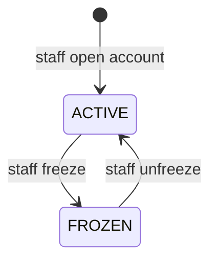

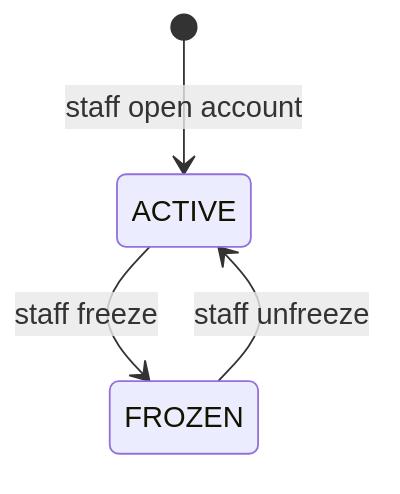

### 11.2 KYC (`customer.kyc_status`)

| From | To | Triggered by | Timestamp |
|---|---|---|---|
| (new) | `PENDING` | Customer registers | `registration_date` |
| `PENDING` | `VERIFIED` | Staff at the home branch | `verified_at` (and `verified_by`) |
| `PENDING` | `REJECTED` | Staff at the home branch, with a reason | audit log time |

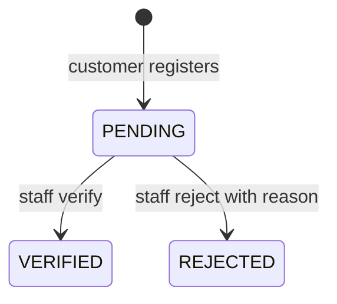

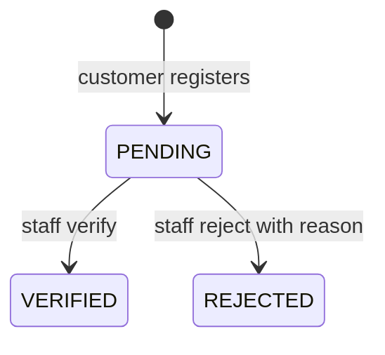

### 11.3 User login (`users.status`)

| From | To | Triggered by | Timestamp |
|---|---|---|---|
| (new) | `ACTIVE` | Customer registers | `created_at` |
| (new) | `PENDING` | Staff registers | `created_at` |
| `PENDING` | `ACTIVE` | Admin approves staff (assigns a branch) | `updated_at` |
| `PENDING` | `BLOCKED` | Admin rejects staff registration | `updated_at` |
| `ACTIVE` | `BLOCKED` | Staff block a customer; admin blocks staff; or the wrong-password lockout | `updated_at` |
| `BLOCKED` | `ACTIVE` | Staff unblock a manually blocked customer; admin unblocks staff; access request approved; admin restores staff access | `updated_at` |

A rejected staff applicant has no branch and cannot be unblocked.

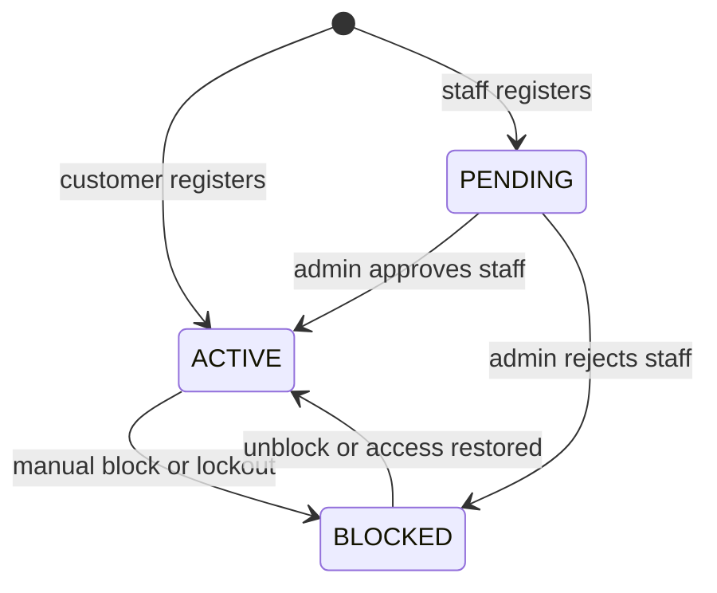

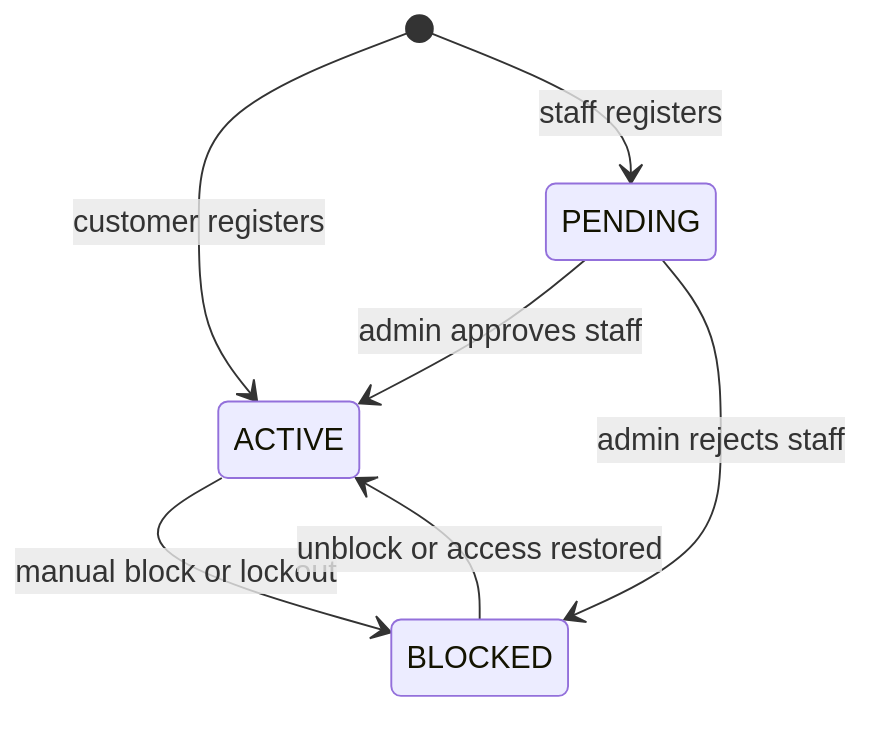

### 11.4 Loan (`loan.status`)

| From | To | Triggered by | Timestamp |
|---|---|---|---|
| (new) | `PENDING` | Customer applies | `application_date` |
| `PENDING` | `AWAITING_ADMIN` | Staff first approval (all four checks recorded) | `staff_approved_at` (and `staff_approved_by`) |
| `PENDING` | `REJECTED` | Staff reject with a reason | `rejected_at` (and `rejected_by`) |
| `AWAITING_ADMIN` | `ACTIVE` | Admin final approval: disbursed by `sp_disburse_loan` | `approval_date` (and `approved_by`, `disbursement_transaction_id`) |
| `AWAITING_ADMIN` | `REJECTED` | Admin rejects with a reason | `rejected_at` (and `rejected_by`) |
| `PENDING` or `AWAITING_ADMIN` | `CANCELLED` | Customer cancels | `cancelled_at` |
| `ACTIVE` | `CLOSED` | Last unpaid instalment paid (`sp_repay_loan`) | `closed_at` |

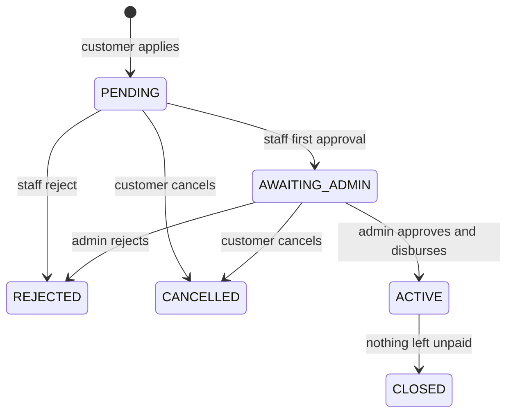

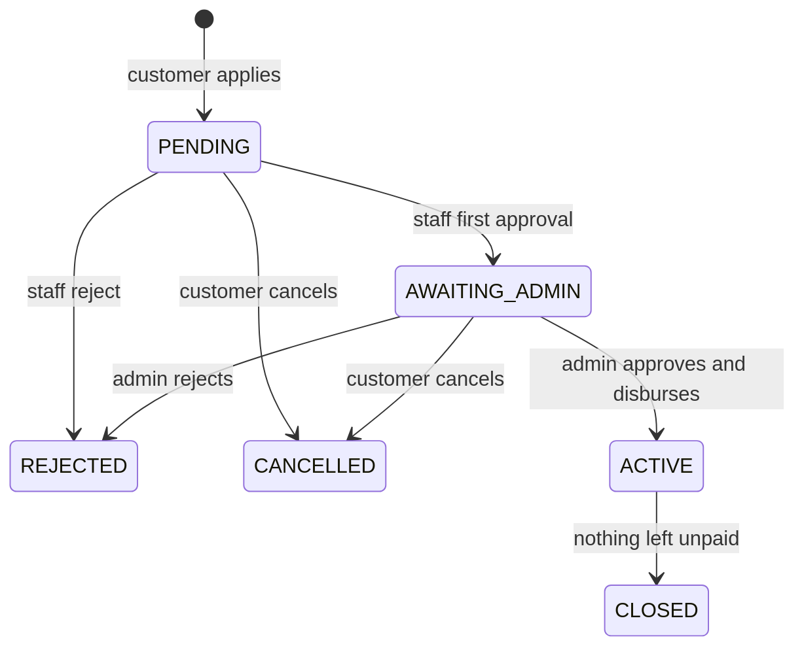

### 11.5 Loan instalment (`loan_instalment.status`)

| From | To | Triggered by | Timestamp |
|---|---|---|---|
| (new) | `UNPAID` | Admin approval saves the schedule (`sp_disburse_loan`) | n/a |
| `UNPAID` | `PAID` | An instalment payment (online or cash) covers the next instalment | `paid_at` (and `loan_payment_id`) |
| `UNPAID` | `SETTLED` | An early payoff settles every remaining instalment | `paid_at` (and `loan_payment_id`, `interest_waived`) |

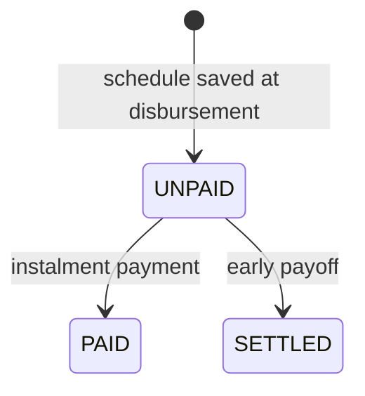

### 11.6 Card (`bank_card.status`)

| From | To | Triggered by | Timestamp |
|---|---|---|---|
| (new) | `REQUESTED` | Customer requests a card | `requested_at` (and `requested_by`) |
| `REQUESTED` | `ACTIVE` | Staff issue the card | `decided_at`, `issued_date`, `expiry_date` (and `decided_by`) |
| `REQUESTED` | `REJECTED` | Staff reject with a reason | `decided_at` (and `decided_by`) |
| `ACTIVE` | `BLOCKED` | Customer blocks the card | audit log time |
| `BLOCKED` | `ACTIVE` | Staff unblock the card | audit log time |

`EXPIRED` exists in the schema but is never set (see [Out of scope](#7-out-of-scope)).

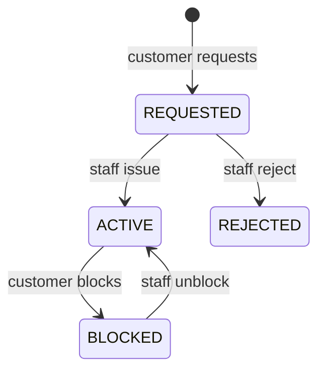

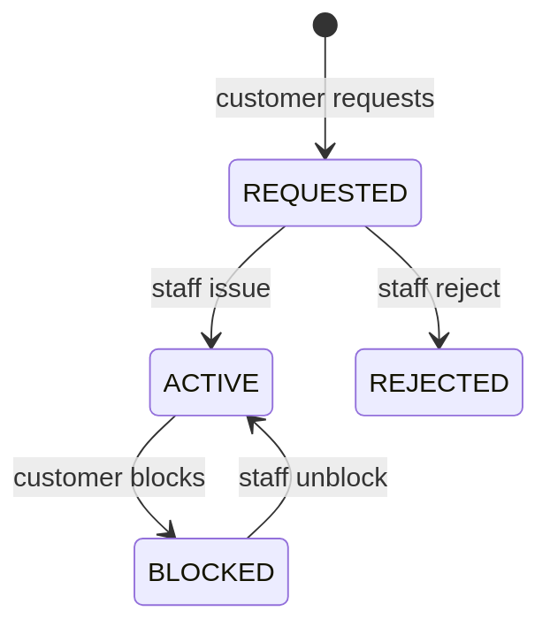

### 11.7 Access request (`access_request.status`)

| From | To | Triggered by | Timestamp |
|---|---|---|---|
| (new) | `PENDING` | Staff at the customer's home branch raise it | `requested_at` (and `requested_by`) |
| `PENDING` | `APPROVED` | Admin approves; the login is restored | `reviewed_at` (and `reviewed_by`) |
| `PENDING` | `REJECTED` | Admin rejects with a reason | `reviewed_at` (and `reviewed_by`) |

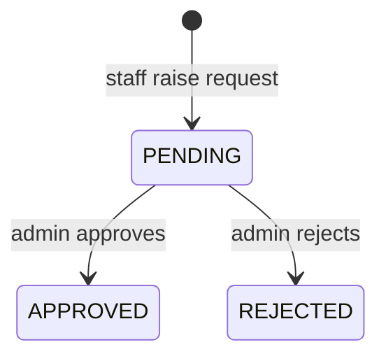

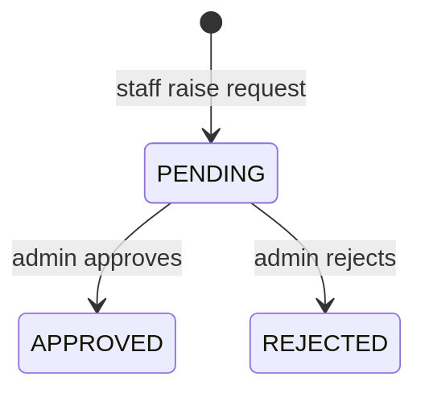

### 11.8 Transfer (`transfer.status`)

A transfer is written in one step by `sp_transfer_funds`, inside a single database transaction, with status
`COMPLETED` and the time in `transfer_date`. A refused transfer writes nothing. `FAILED` and `REVERSED` exist in
the schema but are not used.

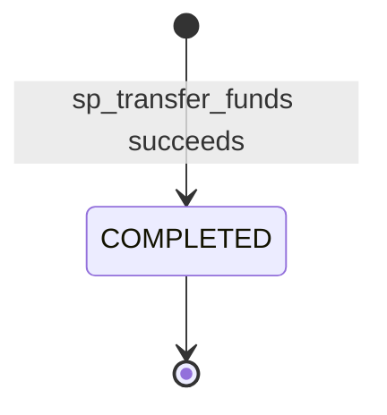

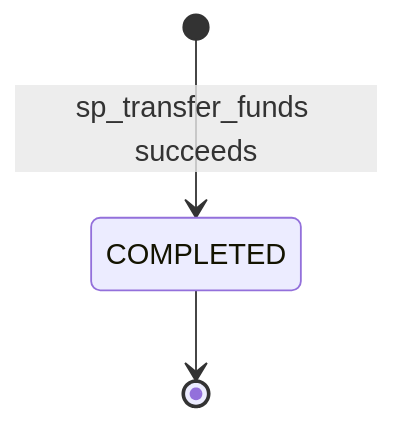

## 12. Payment / transaction requirements

- **PT-1 Stored procedures only.** Every movement of money shall be carried out by a stored procedure that
  runs its own transaction: `sp_open_account`, `sp_deposit`, `sp_withdraw`, `sp_transfer_funds`,
  `sp_disburse_loan` and `sp_repay_loan`. The API shall not update balances directly.
- **PT-2 Transaction types.** Each movement shall be recorded in `transactions` with one of six types:
  `DEPOSIT`, `WITHDRAWAL`, `TRANSFER_OUT`, `TRANSFER_IN`, `LOAN_DISBURSEMENT`, `LOAN_PAYMENT`.
  Each row stores the amount, the channel (`BRANCH` or `ONLINE`) and the balance after the movement.
- **PT-3 Transfers.** A transfer shall write one `transfer` row and two `transactions` rows (out and in).
- **PT-4 Amounts.** Amounts shall be greater than zero with at most two decimal places. The procedures take
  amounts as `DECIMAL(20,6)` so that extra decimals are refused, not rounded.
- **PT-5 Minimum balance.** Withdrawals, transfers and online loan payments shall not take an account
  below its account type's minimum balance. An opening deposit shall be at least that minimum. A database
  CHECK constraint shall stop any balance going below zero.
- **PT-6 Daily transfer limit.** The total transferred out of an account today plus the new amount shall not
  exceed its account type's `daily_transfer_limit`. This is checked inside `sp_transfer_funds`.
  - Code defaults (migration): **Savings GMD 100,000**, **Current GMD 500,000**, any other type GMD 100,000.
  - Demo database: lowered to **Savings GMD 1,000** and **Current GMD 2,000** so the limit can be shown.
  - Configurable by the administrator per account type on the *Account types* page.
- **PT-7 Active accounts.** Money shall move only into and out of `ACTIVE` accounts, and a transfer's two accounts
  shall use the same currency and be different accounts.
- **PT-8 Row locking.** Procedures shall lock the rows they change (`SELECT … FOR UPDATE`). A transfer
  shall lock its two accounts in ascending `account_id` order to avoid deadlocks, and read today's
  transfer total with `FOR SHARE`.
- **PT-9 Errors.** Procedures shall refuse bad input with a clear message (SQLSTATE `45000`).
  `45001` means the loan's status or the amount owed changed while the customer was looking at it.
  `45002` means the transfer is over the daily limit.
- **PT-10 Audit.** Every procedure shall write an `audit_log` row for the movement it makes.
- **PT-11 Loan repayment amount.** For a loan payment, `sp_repay_loan` shall work out the amount owed itself.
  The amount shown to the customer by the API shall always equal the amount the procedure charges (checked by a parity test).

## 13. Notifications

The system has **no real SMS or email delivery**. Text messages are simulated by the **demo SMS outbox**:

- The system shall write each message it would send to the `demo_sms_outbox` table, with the user,
  phone number, purpose, message and time sent.
- Messages sent:
  - after an access request is approved, or staff access is restored, with *unblock and reset*: the
    temporary password, with its expiry and a warning never to share it;
  - after *unblock only*: a notice that the account has been unblocked.
- The messages can be read on the *Demo SMS outbox* page (`/demo/sms-outbox`), which the sign-in page
  links to. The page and its API exist only when `APP_ENV=local`.
- The page shows the last 24 hours of messages. A temporary password is shown only while it can still be
  used. Once it has been used, replaced by a newer one or has expired, it is masked.

## 14. Reporting

Reporting is limited to two summary pages.

- **Admin Overview** (`/admin`): counts of pending staff, active staff (with the number blocked),
  pending access requests, branches, customers (total, and by KYC status: pending, verified, rejected) and
  accounts, plus a Bank details box showing the bank's name (or "Missing" when no bank is set up). Each box
  except Accounts links to its page. Banners appear when the bank is not set up, or when access requests or
  staff registrations are waiting.
- **Staff Dashboard** (`/staff`): a welcome, the quick account or customer search, and counts of customers
  awaiting KYC, verified and rejected, each linking to that tab of the Customers page, with a banner when customers are awaiting KYC.

Daily totals, account statements, exports and charts are not built (see [Future enhancements](#28-future-enhancements)).

## 15. Non-functional requirements

### 15.1 Performance

- **NFR-1** Lists of customers, loans, cards, staff, access requests and audit entries shall be paginated on the server.
- **NFR-2** Lookups shall use indexed columns (primary keys, unique keys such as `account_number`, and foreign keys).
- **NFR-3** Row locks shall be held only inside a single procedure's transaction.

### 15.2 Security

- **NFR-4** The system shall meet the security requirements in [section 24](#24-security-requirements).

### 15.3 Availability

- **NFR-5** The system runs on a single server with one MySQL database. Sessions are stored in the database,
  so restarting the API does not sign users out.
- **NFR-6** If a procedure fails, its transaction shall be rolled back so that no partial money movement remains.

### 15.4 Scalability

- **NFR-7** The API keeps no session state in memory (sessions are in the database), so more API servers could
  share the same database.
- **NFR-8** Branches, account types, card types, loan types and departments are data, not code, so the
  bank can grow without code changes.

### 15.5 Usability

- **NFR-9 Top navigation.** Each role has a top navigation bar:
  - **Admin:** *Overview*, a *Bank setup* dropdown (Bank settings, Branches, Account types, Card types,
    Loan types, Departments), a *People* dropdown (Customers, Staff, Access requests), *Loans* and *Audit log*.
  - **Staff:** *Dashboard*, *Customers*, *Cards*, *Loans* and *Audit log*.
  - **Customer:** *Overview*, *Accounts*, *Transfer*, *Cards* and *Loans*.
- **NFR-10 Customer search.** For admin and staff, the bar has a *Search customers* box that opens the
  Customers page with the search applied.
- **NFR-11 User menu.** A user menu shows the user's name and role, with *Change password* (and *Profile*
  for customers) and *Log out*.
- **NFR-12 Small screens.** Below the large-screen breakpoint the links collapse into a *Menu* button.
  Pages lay out in one column at phone width without sideways scrolling, and tables become cards.
- **NFR-13 Keyboard and focus.** Dropdowns close on Escape (returning focus to their button) and on a click
  or focus outside them. Every interactive element has a visible keyboard focus ring.
- **NFR-14 Feedback.** Forms show errors next to each field, and clear them when the field is edited. Buttons
  show a loading state and cannot be pressed twice. The idle warning shows a countdown.
- **NFR-15 Language.** Messages are in plain English, and amounts are shown with the GMD label.

### 15.6 Maintainability

- **NFR-16** The database schema shall be changed only by Laravel migrations. On `bank_db`, migrations shall be
  additive (no rebuilds), because it holds real data.
- **NFR-17** Configurable values (limits, timeouts, card BIN, loan limits) shall be read from `.env` with
  defaults in `config/bank.php`.
- **NFR-18** Backend behaviour shall be covered by automated Pest tests, and the frontend by unit tests, lint and a build check.

## 16. Database requirements

The database `bank_db` (MySQL 8) has **27 bank tables**, linked by **52 foreign keys**, all `ON DELETE RESTRICT`.
Laravel's own tables (`sessions`, `cache`, `cache_locks`, `jobs`, `job_batches`, `failed_jobs`,
`migrations`) are not counted. The full entity relationship diagram, with cardinality and the
procedure table, is in **[ERD.md](ERD.md)**.

### 16.1 Main entities and relationships

| Area | Entities | Key relationships |
|---|---|---|
| People and access | `bank`, `branch`, `customer`, `customer_address`, `employee`, `employee_branch_lnk`, `employee_department_lnk`, `department`, `role`, `users`, `access_request`, `demo_sms_outbox` | A bank has many branches. A customer has one home branch. A login (`users`) has one role and belongs to at most one customer or one employee. An employee's branch and department history is kept in the two link tables. |
| Accounts and money | `account`, `account_type`, `transactions`, `transaction_type`, `transfer` | A customer has many accounts, each with one type and one branch. An account has many transactions. A transfer references its two accounts, and its two transactions point back to it. |
| Cards | `bank_card`, `card_type` | An account has many cards over time, at most one of them live (requested or active). Each card has one card type. |
| Loans | `loan_type`, `loan`, `loan_application`, `loan_guarantor`, `loan_verification`, `loan_instalment`, `loan_payment` | A loan has at most one application record and one guarantor, up to four verification checks, many instalments and many payments. |
| Audit | `audit_log` | Each row may reference the user who acted. |

### 16.2 Database rules

- **DB-1** Every table shall have a primary key, and every reference shall be a foreign key with `ON DELETE RESTRICT`.
- **DB-2** Unique keys shall protect account numbers, card number hashes, national IDs, emails, usernames,
  branch codes, the SWIFT code and type names.
- **DB-3** CHECK constraints shall protect balances, amounts, loan totals and terms, interest rates, the
  daily transfer limit, and that each login belongs to exactly one customer or employee.
- **DB-4** A generated, unique column (`access_request.pending_customer_id`) shall allow at most one pending
  access request per customer.
- **DB-5** The six stored procedures and two functions listed in [ERD.md](ERD.md#stored-procedures-and-functions) shall carry out all money movements.

### 16.3 Diagrams

Full diagram (all 27 tables):

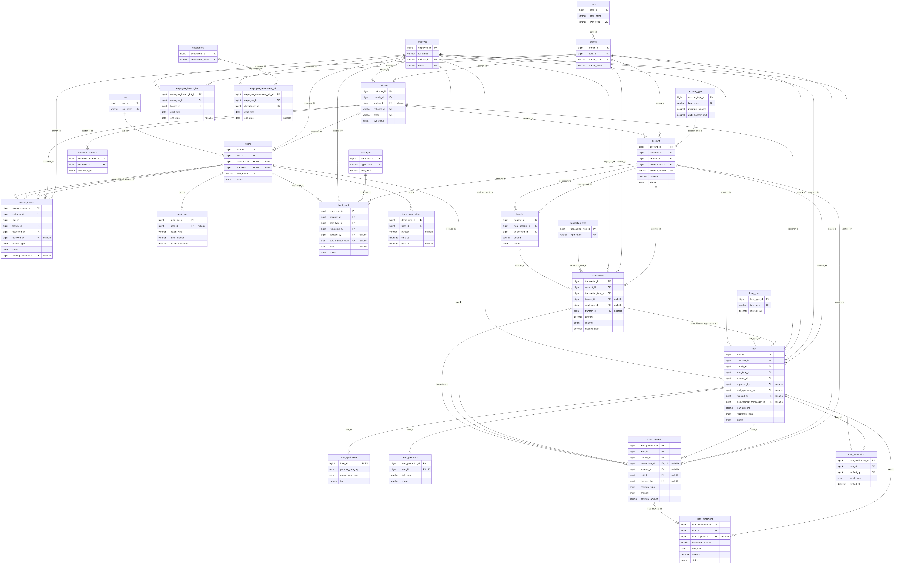

People and access:

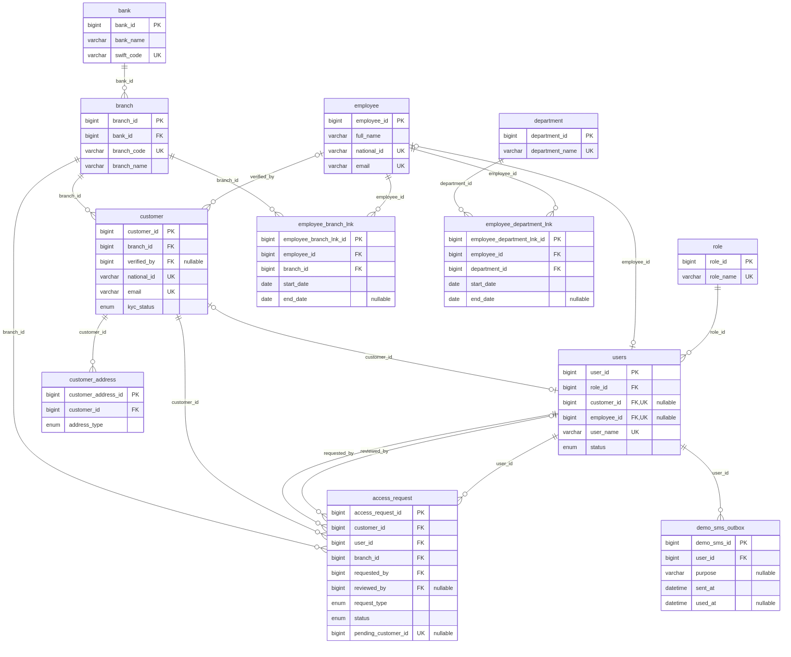

Accounts and money:

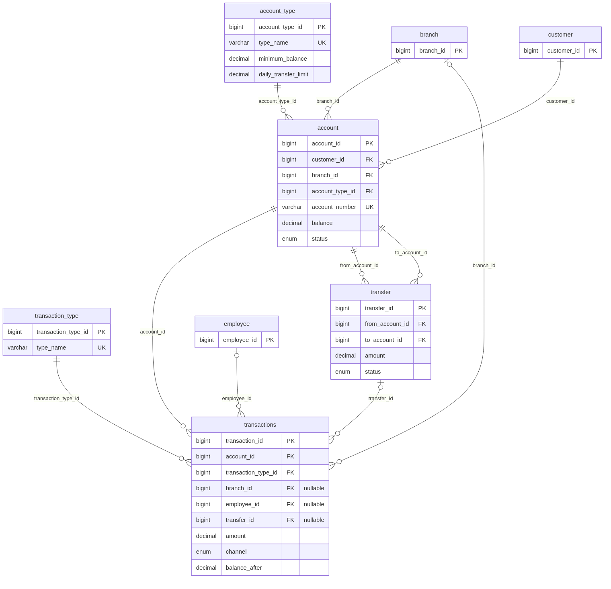

Cards:

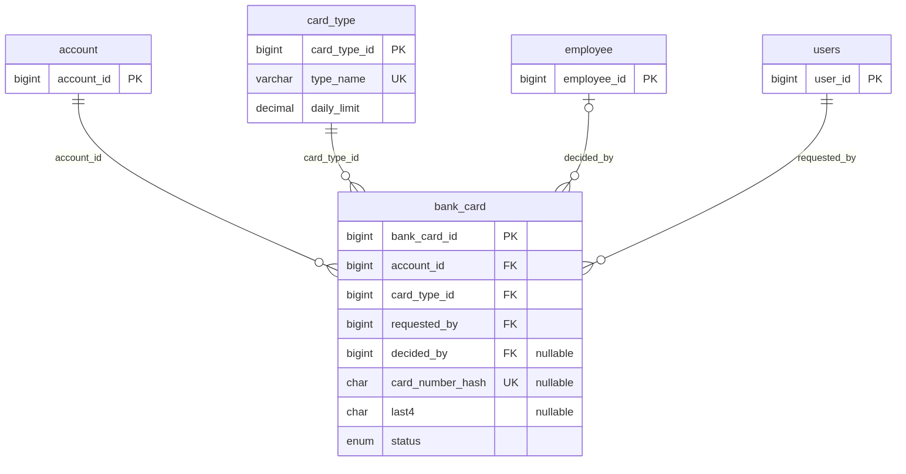

Loans:

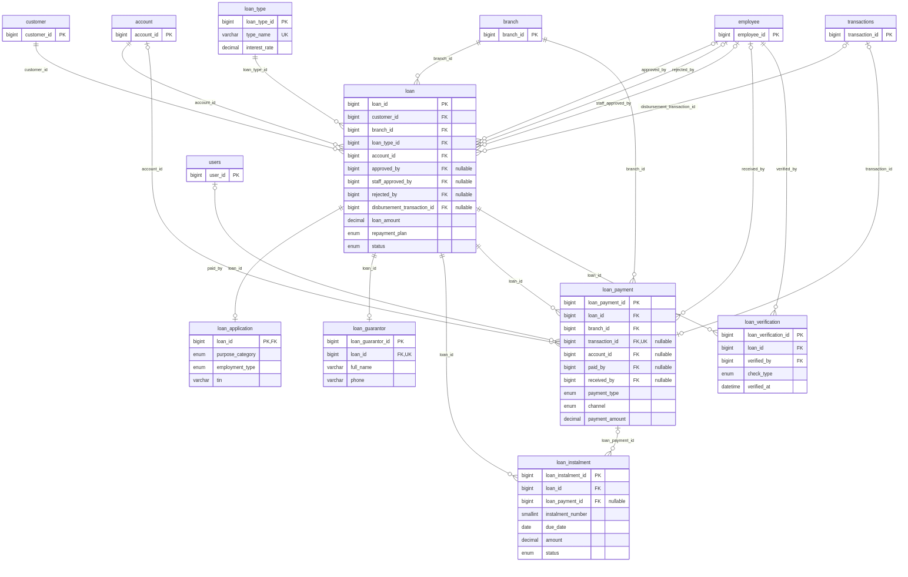

Audit:

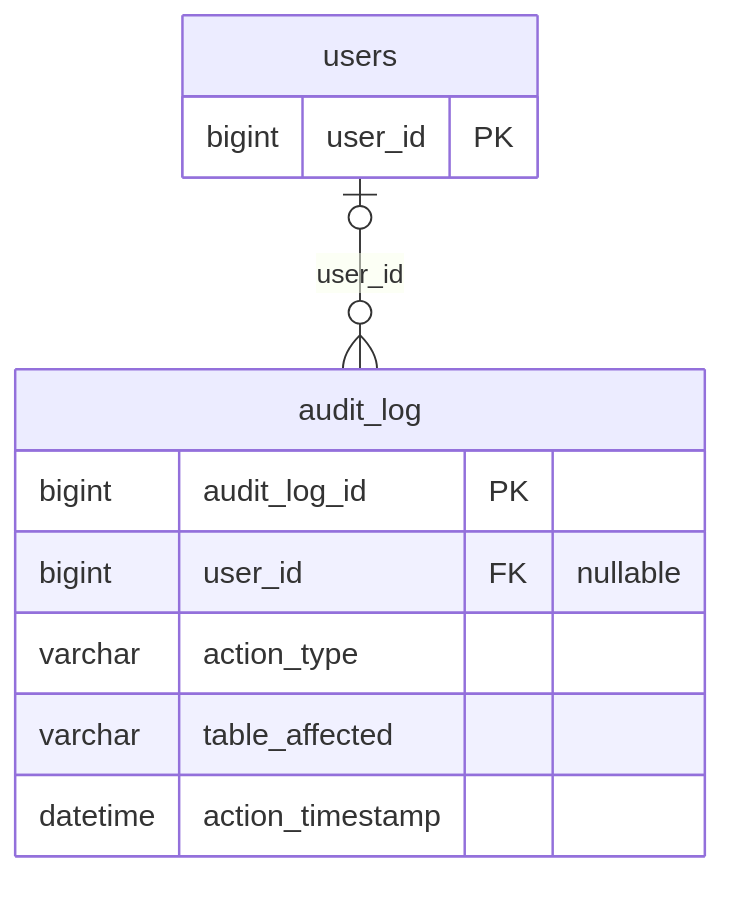

## 17. Business rules

- **BR-001** Customer, staff and guarantor phone numbers shall be Gambian mobile numbers: 9 digits starting with
  83 (QCell), 86 (Comium) or 87 (Africell), following PURA's September 2026 numbering migration. Gamcel
  numbers are not accepted.
- **BR-002** Branch and employer phone numbers may be landlines: digits and spaces with an optional leading `+`.
- **BR-003** All amounts are in Gambian dalasi (GMD) with two decimal places.
- **BR-004** A customer's KYC must be `VERIFIED` before an account can be opened, a card requested or a loan applied for.
- **BR-005** An account's initial deposit must be at least its account type's minimum balance.
- **BR-006** No withdrawal, transfer or online loan payment may take an account below its type's minimum balance.
- **BR-007** The daily transfer limit is per source account, set on its account type. It counts completed
  transfers out of the account on any channel, and resets at midnight Africa/Banjul time.
- **BR-008** A customer may transfer only from their own accounts, only between active accounts, and only in the same currency.
- **BR-009** A loan amount must be between GMD 1,000 and GMD 5,000,000 (`BANK_LOAN_MIN_AMOUNT`, `BANK_LOAN_MAX_AMOUNT`).
- **BR-010** A loan term must be from 1 to 12 months (`BANK_LOAN_MIN_TERM_MONTHS`, `BANK_LOAN_MAX_TERM_MONTHS`).
- **BR-011** A loan's repayment plan is either *Monthly* (equal monthly instalments) or *Single* (one repayment at the end of the term).
- **BR-012** If the monthly repayment is more than 33% of the declared monthly income
  (`BANK_LOAN_AFFORDABILITY_WARNING_PERCENT`), staff and admins see a warning. The loan is not rejected automatically.
- **BR-013** A customer may have only one open loan (`PENDING`, `AWAITING_ADMIN` or `ACTIVE`).
- **BR-014** Every loan needs two approvals: staff at the loan's branch (after all four checks), then an
  administrator. Only the administrator's approval pays the loan out.
- **BR-015** Early payoff:
  - *Monthly plan:* overdue instalments and the current month's instalment are paid in full with their
    interest. Later instalments are paid as principal only.
  - *Single plan:* the principal plus interest for the months started since disbursement (at least 1, at most the full term).
- **BR-016** An account may have only one live card (`REQUESTED` or `ACTIVE`) at a time.
- **BR-017** Wrong-password lockout, counted per user across the sign-in page and the in-app password checks
  (transfers, card reveal, loan payments, change password):
  - 5 wrong passwords: locked for 1 minute (`LOCKOUT_FIRST_MINUTES`);
  - the next wrong password after that lock: locked for 2 minutes (`LOCKOUT_SECOND_MINUTES`);
  - the next wrong password after that: the login is **blocked** and its sessions end;
  - admins get repeated 2-minute locks but are never blocked;
  - a correct password clears the count, and the count is forgotten 24 hours after the last wrong password (`LOCKOUT_RESET_HOURS`).
- **BR-018** The sign-in page allows at most 30 failed attempts a minute from one IP address.
- **BR-019** Passwords must be at least 8 characters and contain letters and numbers. A new password must differ from the current one.
- **BR-020** A temporary password expires after 24 hours (`TEMP_PASSWORD_EXPIRY_MINUTES`, default 1440) and
  must be changed at the next sign-in.
- **BR-021** A session is logged out after a period without user activity, set by `IDLE_TIMEOUT_MINUTES`.
  The code default is **5 minutes**; the demo `.env` sets **2 minutes**. The warning appears 60 seconds before.
- **BR-022** Staff may change customers (details, KYC, login block, access requests), freeze accounts, and
  handle cards and loans only at their own current branch. Viewing customers and cash deposits and withdrawals are allowed at every branch.
- **BR-023** A customer locked out by wrong passwords can only be reopened through an access request raised by
  staff at the home branch and approved by an administrator. A staff member is reopened only by an administrator (*Restore access*).
- **BR-024** A customer may have at most one pending access request.
- **BR-025** An expired temporary password can only be recovered with *unblock and reset* (a new temporary password).
- **BR-026** Card numbers start with the BIN 990000 (`BANK_CARD_BIN`), a range that never matches a real card
  network, and end with a Luhn check digit. A card expires at the end of the month 3 years after issue (`BANK_CARD_VALIDITY_YEARS`).
- **BR-027** A customer's national ID can be changed by staff only while KYC is pending.
- **BR-028** Staff without a current branch are refused in the staff area. An administrator without a branch may still read the audit log.
- **BR-029** A customer must be at least 18 years old to register.

## 18. Assumptions

- There is one bank, and all of its branches use the same system.
- All accounts use one currency, GMD.
- Staff check a customer's identity in person or by phone before raising an access request.
- The frontend and the API are served from addresses that can share session cookies (configured with
  `SANCTUM_STATEFUL_DOMAINS` and `FRONTEND_URL`).
- The demo SMS outbox stands in for an SMS gateway during development and demonstration.
- Users have a modern web browser with JavaScript enabled.

## 19. Constraints

- **Technology:** PHP ^8.3, Laravel ^13.17, Laravel Sanctum ^4.3, Pest ^4.7; React ^19.2.8, React Router ^8.4.0,
  Vite ^8.3.0, Tailwind CSS ^4.3.3, axios ^1.20.0; MySQL 8 (versions from `composer.json` and `package.json`).
- **Database:** money rules must live in MySQL stored procedures. Table names are lowercase on a server with
  case-sensitive names.
- **Data safety:** `bank_db` holds real entered data, so schema changes must be additive migrations. Tests use
  the separate `bank_db_testing` database only.
- **Deployment:** the system runs locally. There is no public hosting or HTTPS yet.
- **Phone numbers:** only QCell, Comium and Africell prefixes are supported.
- **Time:** an academic project timeline.

## 20. Feasibility

| Type | Assessment |
|---|---|
| Technical | Feasible and demonstrated. The system is built on widely used open-source tools, and the stored procedures, row locking and concurrency are covered by automated tests. |
| Economic | Low cost. All software is open source with no licence fees. Development and demonstration run on one computer. Real SMS and hosting would add running costs later. |
| Operational | Feasible. Each role has a focused area that follows existing bank roles (customer, teller/officer, administrator), and staff work is scoped to their branch. |
| Legal | Customer data is personal and financial. The system limits who can see it (roles, branch scoping, ownership checks), masks card numbers and keeps an audit trail. A live deployment would need a review against Gambian banking regulation and data protection law; this document does not claim compliance. |
| Schedule | Feasible. The system was built between 3 and 20 October 2026 in phases (schema and procedures, then features by role, security, access recovery, the redesign and documentation), each accepted with tests passing. |

## 21. SMART goals

1. **Specific and measurable:** every movement of money (6 kinds) goes through one of the 6 stored
   procedures, with no direct balance updates in the API. *Achievable* with MySQL procedures;
   *relevant* to balance integrity; *time-bound* to the core build (by 20 October 2026). Status: met.
2. **Every phase is accepted only with all tests passing**: the backend suite, the frontend unit tests, lint
   and the production build. Status: met at the time of writing (see [Testing](#25-testing)).
3. **Every loan receives two approvals by two different roles** before any money is paid, enforced by
   `sp_disburse_loan` accepting only `AWAITING_ADMIN` loans approved by an administrator. Status: met.
4. **A locked-out customer can be restored within one working session** (staff request plus admin approval)
   without anyone seeing their password, measured by the access-recovery tests and the demo SMS outbox. Status: met.
5. **Every customer-facing page is usable at phone width** without sideways scrolling, checked in the
   browser for each page in the G3 redesign. Status: met.

## 22. Use cases

### UC-1: Customer transfers money

| | |
|---|---|
| **Actor** | Customer |
| **Preconditions** | Signed in; owns at least one `ACTIVE` account; not locked out. |
| **Main flow** | 1. The customer opens *Transfer*. 2. They choose a source account and see the day's remaining limit. 3. They enter the destination account number, amount and an optional description, then continue. 4. The system looks up the destination and shows the holder's masked name. 5. The customer reviews and enters their password. 6. The system runs `sp_transfer_funds`: it locks both accounts, checks the rules, writes the transfer, two transactions and an audit row, and commits. 7. The system shows the new balance. |
| **Alternative flows** | 4a. The account does not exist or cannot receive transfers: the system says "This account can't receive transfers". 6a. Wrong password: refused, and it counts toward the lockout (BR-017). 6b. Below the minimum balance, over the daily limit (`45002`), a destination that is not active, or a currency mismatch: refused with the reason, and nothing is written. 6c. Too many lookups: throttled. |
| **Postconditions** | Both balances are updated. The transfer is `COMPLETED` and audited. |

### UC-2: Staff open an account

| | |
|---|---|
| **Actor** | Staff |
| **Preconditions** | Signed in with a current branch; the customer's KYC is `VERIFIED`. |
| **Main flow** | 1. The staff member finds the customer (Dashboard search or *Customers*) and opens their detail page. 2. They choose *Open account*, then the account type and initial deposit. The account is opened at the staff member's current branch. 3. The system runs `sp_open_account`: it creates the account (`ACTIVE`), sets the number `DB` + 3-digit branch + 7-digit id, records the initial deposit transaction and writes an audit row. 4. The new account appears on the customer's page. |
| **Alternative flows** | 3a. KYC not verified: refused. 3b. Deposit below the type's minimum balance: refused. 3c. Unknown account type: refused. |
| **Postconditions** | The customer has a new active account with a balance equal to the deposit. |

### UC-3: Loan application, staff approval and admin disbursement

| | |
|---|---|
| **Actors** | Customer, staff (at the loan's branch), administrator |
| **Preconditions** | The customer is KYC-verified, has no open loan and owns an active account. |
| **Main flow** | 1. The customer opens *Loans* and chooses to apply. 2. Step 1: they choose the loan type, amount, term and plan, and see a live quote. 3. Step 2: employment and income. 4. Step 3: guarantor details. 5. Step 4: they review, confirm and submit. The loan is `PENDING`. 6. Staff open the loan, review the 6-month statement and the affordability figures, and record the four checks. 7. Staff give the first approval, and the loan becomes `AWAITING_ADMIN`. 8. The administrator reviews it and approves. `sp_disburse_loan` checks the schedule, saves the instalments (`UNPAID`), pays the amount into the account and makes the loan `ACTIVE`. 9. The customer sees the loan, its schedule and the credit on their account. |
| **Alternative flows** | 2a. Amount or term outside the limits: refused. 5a. The customer cancels before a decision: `CANCELLED`. 6a. Above the affordability percentage: a warning is shown, and staff decide. 7a. Staff reject with a reason: `REJECTED`. 7b. Not all checks recorded: the first approval is refused. 8a. The administrator rejects with a reason: `REJECTED`. 8b. The loan changed meanwhile (`45001`): refused, and the page reloads. |
| **Postconditions** | The loan is `ACTIVE` with a schedule. A `LOAN_DISBURSEMENT` transaction is recorded. Every step is audited. |

### UC-4: A blocked customer recovers access

| | |
|---|---|
| **Actors** | Customer, staff (at the customer's home branch), administrator |
| **Preconditions** | The customer's login was blocked by the wrong-password lockout (or their temporary password expired). |
| **Main flow** | 1. The customer visits or phones their home branch. 2. Staff open the customer, confirm their identity (date of birth, phone, account history, declaration), record the contact channel and choose *unblock and reset password*. 3. The system creates a `PENDING` access request. 4. The administrator opens *Access requests*, reviews it and approves. 5. The system sets the login to `ACTIVE`, clears the lockout count, ends old sessions, generates a temporary password and sends it by (demo) SMS. 6. The customer signs in with it and is made to choose a new password. |
| **Alternative flows** | 2a. *Unblock only* (lockout cases): the login is reopened with the existing password, and a notice is sent. 3a. A pending request already exists: refused. 4a. The administrator rejects with a reason: the login stays blocked. 6a. The temporary password expired (24 h): it is refused, and a new request is needed. |
| **Postconditions** | The customer can sign in again with a password only they know. Every step is audited. |

## 23. System architecture

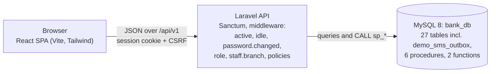

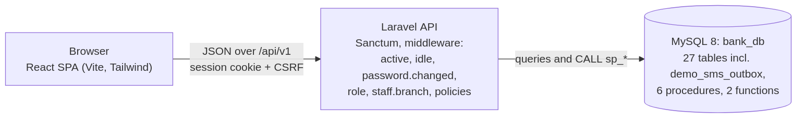

- **Frontend:** a React single-page application with role-based layouts and a top navigation bar. It calls the
  API with axios and never calculates money itself.
- **Backend:** a Laravel API under `/api/v1`. Sanctum cookie sessions with CSRF protection authenticate every
  request. A middleware chain checks the user is active, the session is not idle and the password has been
  changed, then the role and staff branch. Policies check branch ownership. Controllers call the stored
  procedures for every money movement and write the audit log.
- **Database:** MySQL 8 (`bank_db`), with constraints, foreign keys and the stored procedures that hold the money rules.

## 24. Security requirements

- **SEC-01 Authentication.** Every API route except registration, sign-in, the branch list and the feature flag
  shall require a signed-in, active user (Sanctum session cookie with CSRF protection).
- **SEC-02 Role checks.** The customer, staff and admin parts of the API shall each be restricted to their role.
- **SEC-03 Ownership.** Customers shall only reach their own accounts, cards and loans. Others shall be answered with "not found".
- **SEC-04 Branch scoping.** Staff actions that change data shall be limited to their branch as in BR-022, enforced by policies and middleware.
- **SEC-05 Lockout.** Wrong passwords shall be limited as in BR-017. A blocked user's sessions shall end immediately.
- **SEC-06 Idle logout.** Sessions shall be ended by the server after the idle timeout (BR-021).
- **SEC-07 Forced password change.** Users with a temporary or seeded password shall be able to do nothing but change it or sign out.
- **SEC-08 Password storage.** Passwords shall be stored hashed, never in plain text.
- **SEC-09 No admin access to passwords.** There shall be no route for any user to see or set another user's password.
- **SEC-10 Temporary passwords.** These shall be random, 12 characters long, generated by the system, sent only
  by (demo) SMS, never returned by the API or written to logs, and expire after 24 hours.
- **SEC-11 Card numbers.** These shall be stored encrypted, with a hash for uniqueness and the last four digits
  kept separately. They shall be shown masked, in full only to the owner after a password check, and the audit log shall record only the last four digits.
- **SEC-12 Throttles.** Per minute:
  - registrations: 5 per IP address (both forms together);
  - transfer recipient lookups: 10 per user;
  - loan quotes: 30 per user;
  - password actions (transfers, card reveal, loan payments, change password): 60 per user;
  - activity pings: 60 per user;
  - failed sign-ins: 30 per IP address.
- **SEC-13 Audit.** Security events (sign-ins, failed sign-ins, lockouts, blocks, access restores, temporary
  passwords issued) and all data changes shall be audited with user, IP address and time.
- **SEC-14 Demo-only features.** The demo SMS outbox route shall return 404 unless `APP_ENV=local`.
- **SEC-15 Database integrity.** Money rules shall be enforced in the database (procedures, CHECK
  constraints, row locks), so a fault in the API cannot break them.

## 25. Testing

### 25.1 Strategy

- **Backend feature tests (Pest)** for authentication, every role's features, validation, security
  (lockout, branch scoping, idle logout, throttles), access recovery and migrations.
- **Stored procedure tests**, including concurrency tests that run operations in parallel to prove the row locking.
- **Unit tests** for amortisation, card number generation (Luhn), instalment status and loan repayment.
- **Parity test** that the PHP repayment quote always equals what `sp_repay_loan` charges.
- **Frontend unit tests** (Node's test runner) for money formatting, phone validation, form errors and the cross-tab idle logout.
- **Static checks:** oxlint, and a production build with Vite.
- **Manual browser review** of each redesigned page at desktop and phone width.

Backend tests run only against `bank_db_testing`, never `bank_db`.

### 25.2 Current results

Results from a test run on 20 October 2026:

| Suite | Command | Result |
|---|---|---|
| Backend | `php artisan test` | **612 tests, 13,957 assertions, all passing** (about 8 minutes) |
| Frontend unit tests | `npm test` | **14 tests, all passing** |
| Frontend lint | `npm run lint` | No warnings or errors |
| Frontend build | `npm run build` | Builds successfully (Vite notes one chunk larger than 500 kB, a size advisory, not an error) |

## 26. Acceptance criteria

The system is accepted when all of the following hold:

- [ ] A customer can register, sign in and see their Overview (FR-001, FR-003, FR-010).
- [ ] Staff registration stays pending until an admin approves it with a branch (FR-002, FR-053).
- [ ] A transfer moves money between two active accounts after a password check, and is refused below the
      minimum balance or over the daily limit (FR-014 to FR-016, BR-006, BR-007).
- [ ] Staff can open an account only for a KYC-verified customer, with a deposit of at least the minimum (FR-041, BR-004, BR-005).
- [ ] Cash deposits and withdrawals update the balance and appear in the history (FR-042).
- [ ] A card can be requested, issued, blocked, unblocked and revealed only by its owner (FR-017 to FR-022).
- [ ] A loan passes staff checks, first approval and admin approval before it is paid out, and can be repaid
      online, in cash or early until it closes (FR-023 to FR-035, BR-014, BR-015).
- [ ] Five wrong passwords lock the user, and the third stage blocks a non-admin login (BR-017).
- [ ] A blocked customer can be restored only through a staff request approved by an admin, and receives a
      temporary password in the demo SMS outbox that must be changed (FR-045 to FR-050).
- [ ] An idle session is logged out after the configured timeout, with a warning first (FR-008, FR-009).
- [ ] Staff cannot change customers or accounts at another branch (BR-022).
- [ ] Every change appears in the audit log, scoped by role (FR-058 to FR-060).
- [ ] The admin Overview and staff Dashboard show correct counts with working links (section 14).
- [ ] All backend tests, frontend tests, lint and build pass (section 25).

## 27. Risk analysis

| Risk | Likelihood | Impact | Mitigation (as built) |
|---|---|---|---|
| Two operations on one account at once give a wrong balance | Medium | High | Row locks in every procedure, a fixed lock order for transfers, concurrency tests. |
| Password guessing | Medium | High | Lockout with a block at the third stage; per-IP sign-in limit; audit of failed sign-ins. |
| Staff misuse at another branch | Low | High | Branch-scoping policies and middleware; audit log. |
| One person approves and pays a loan | Low | High | Two approvals by different roles; disbursement only by an admin through `sp_disburse_loan`. |
| Session left open on a shared computer | Medium | Medium | Server-side idle logout with a warning; cross-tab logout. |
| Temporary password intercepted | Low | High | Random, system-generated, 24-hour expiry, forced change, masked once used. |
| No real SMS gateway | Certain (demo) | Medium | Demo SMS outbox, local only; real SMS listed as future work. |
| Demo limits (transfer limit, idle timeout) left in a live setup | Medium | Medium | Both are configurable; code defaults are 100,000 / 500,000 and 5 minutes; documented in this SRS and the README. |
| Data loss from a schema rebuild | Low | High | Additive migrations only on `bank_db`; tests on a separate database. |
| Single server failure | Medium | High | Not mitigated yet: online deployment with backups is future work. |

## 28. Future enhancements

- **Virtual cards.**
- **Card payments and card limits**, including enforcing each card type's daily limit.
- **Automatic loan repayment deduction** on each instalment's due date.
- **Online registration for existing branch customers with OTP**, so people who already bank at a branch can link an online login with a one-time code.
- **Real SMS delivery** through an SMS gateway, replacing the demo outbox.
- **Gamcel numbers** in the phone rule.
- **Online deployment with HTTPS**, with backups and monitoring.
- **Detailed reports:** daily transaction totals, account statements, exports and charts.
- **Mobile app** (the schema already reserves the `MOBILE` channel).
- Features for the schema values that are reserved but unused: closing accounts, card expiry processing,
  and transfer and payment reversals.

## 29. Deliverables

| Deliverable | Location |
|---|---|
| Backend source (Laravel API) | `backend/` |
| Frontend source (React app) | `frontend/` |
| Database migrations, stored procedures and seeders | `backend/database/` |
| Automated tests | `backend/tests/`, `frontend/src/**/*.test.js` |
| Project README (installation, configuration, features) | `README.md` |
| Entity relationship diagrams | `docs/ERD.md`, `docs/erd/*.png` |
| Software Requirements Specification | `docs/SRS.md`, `docs/srs/*.png` |

## 30. Conclusion

Diamond Bank gives customers secure online access to their accounts, transfers, cards and loans. It gives
branch staff and an administrator the tools to run daily operations within clear limits. Its key qualities are
that money moves only through database procedures with row locking, every loan needs two approvals, staff
power is scoped to their branch, locked-out users regain access without anyone seeing their password, and
every action is audited. The features that are not yet built, from real SMS and online deployment to card
payments and detailed reports, are listed as future enhancements and build on the same foundation.
